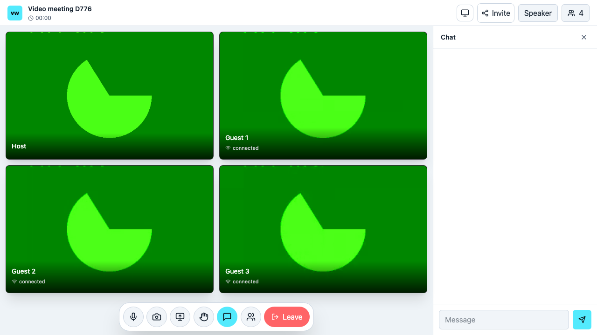

# VideoWhisper WebRTC Video Conference

Free, self-hostable video meetings for small groups, with camera/microphone, optional screen sharing, chat, gallery/speaker layouts, hand raising and host controls. The same React client runs in the PHP standalone edition and WordPress plugin.

**Try the [live conference demo](https://demo.videowhisper.com/video-conference/).** Create a room once, then copy its invitation into another browser or send it to your participants. Standalone edition 0.2.2 includes the PHP demo quota/idle-cleanup fix and generated editable room/guest names. The separately reviewed WordPress edition remains 0.2.1. This is a peer-to-peer mesh application with a technical maximum of four participants. A low-bandwidth profile helps small meetings fit developer hosting plans; screen sharing uses additional plan resources. It has no recording, SFU, file transfer or shared playback.



## Bring everyone into the same room

- **Create once, invite everyone.** Use Invite in the lobby or meeting to copy the room URL. Creating a second room starts a separate meeting.
- **Private rooms** include a random access key in the invitation. Only share the complete link with intended guests.
- **Public rooms** can be joined without an access key. The PHP demo lists public rooms with recently present participants; private rooms are never listed.
- **WordPress meetings** have their own `/conference/room-name/` URLs and an Open conference action in the meeting list/editor. Keep signed-in access, choose a private invitation, or explicitly allow a public room.
- **Responsive panels** stack beneath video on narrow screens. Choose light, dark or system mode (the default). Raised hands appear on participant tiles and in People.

[WebRTC hosting](https://webrtchost.com/) · [Turnkey live streaming sites](https://site2stream.com/live/) · [Setup, support and abuse reports](https://consult.videowhisper.com/)

## Try it locally without a production account

Requires Node.js 22+, npm, Python 3 (packaging/label generation), PHP 8.2+ and a Chromium browser installed by Playwright.

```sh
npm ci
npm run build
npx playwright install chromium
npm run test:server
npm run test:php
npm test
npm run test:e2e
```

For an interactive local demo, run `node tests/dev-server.cjs` and visit http://127.0.0.1:8091 . The harness creates random temporary account/signing secrets and a local server implementing a test-fixture copy of the conference module from server 2026.11.10. It does not load the production server's .env, database, certificates or premium modules. Stop with Ctrl-C. Use separate browser profiles for participants; tabs in the same profile deliberately share a browser identity.

The fake-media browser tests exercise real RTCPeerConnection offers/answers, tracks and ICE on loopback. They do not prove TURN, physical devices or cross-network reliability. The deployment owner must still complete physical-device and two-network checks.

## Deploy the PHP edition

1. Use version 2026.11.10 or later of your [VideoWhisper signaling server](https://github.com/videowhisper/videowhisper-webrtc). The additive extension must be enabled on a **controlled staging server first**. The managed development demo already uses it; the matching public server source release is being prepared, so verify the actual version/capabilities before installing a GitHub snapshot. Do not copy a local env file or replace another integration's callback.
2. Run `npm ci && npm run build`. This copies static assets and shared ticket code to editions/php/.
3. Deploy **only editions/php/** to an HTTPS document root or subdirectory. Set these environment variables in the PHP service configuration, outside the webroot:

| Variable | Value |
|---|---|
| VWC_SOCKET_URL | HTTPS signaling origin, without /conference |
| VWC_ACCOUNT | dedicated Node server account name |
| VWC_ACCOUNT_TOKEN | that account's server-side token |
| VWC_SIGNING_KEY | independent random secret, at least 32 characters |
| VWC_STORAGE_DIR | writable private directory outside the document root |

4. Configure that dedicated Node account's `properties.loginURL` to `https://YOUR-SITE/PATH/?action=auth`. Preserve callbacks for all other integrations. Configure TURN on the Node service for cross-network calls.
5. Open the PHP page, create a meeting and share its invitation URL. Private guests use the complete URL including its access key. Public rooms can also be found in the active-room directory. Guests open the invitation and explicitly join. Only the browser session that created the room is host. Avoid opening two participants in the same browser profile. In WordPress, one signed-in account is one participant; use different accounts or an anonymous browser for guest testing. Before downgrading WordPress to an older release without private-key support, unpublish private-key rooms so older access rules cannot widen access.

The demo host limits creation to ten rooms per browser per hour, sixty per IP per hour and twenty unexpired room reservations. Rooms expire after one hour or five minutes without page/presence activity; a locked private JSON ledger stores random room IDs, titles, access-key hashes, expiry, HMAC IP/session digests and bounded presence timestamps. Presence refreshes while the admitted meeting is open and expires after 60 seconds; it is an approximate directory indicator, not a measured attendance record. It tracks at most 16 recent browser identities per room. Expired ledger records are removed during the next page/presence request; arrange a daily private-directory cleanup if the demo is idle. Creation denials explain the limit and retry time; joining existing rooms remains available. Private environment settings can adjust the limits (see editions/php/README.md). Clearing cookies resets browser identity, so the shared-IP cap and edge protection remain necessary. Reverse proxies must supply trusted HTTPS/remote-address information; add edge request and concurrent-socket limits before exposing a public demo. PHP never proxies media. The PHP built-in server is for local testing only.

Browser PINs are signed bearer credentials scoped to one account, user, room, role and expiry. They are intentionally visible to their participant browser; the reusable account token and signing key never enter browser config, share URLs or static assets. Reload after expiry. No automatic CRM connection or telemetry is included.

## WordPress Free edition

Public plugin source is in `editions/wordpress/`. The development workspace keeps its canonical copy under `wordpress/videowhisper-video-conference/trunk/`. Install the generated `videowhisper-video-conference-0.2.1.zip` after reviewing the release gates. Requires WordPress 6.9+ and PHP 8.2+; use a currently supported PHP hosting branch.

Configure Video Conferences > Settings with a **dedicated** account, then create and publish a Video Conference. Use **Open conference** in the meeting list/editor to open its frontend URL and **Invite** to share it. `[videowhisper_conference id="123"]` is available for optional embedding. Signed-in users who can edit the meeting are hosts; other signed-in participants are guests. New meetings require signed-in members by default. Private mode allows guests holding a complete invitation with its access key. Public mode allows anyone with the room URL. Existing access settings are preserved. Private keys can be replaced in the editor; this rejects previous invitations/credentials on new connections, without disconnecting participants already present. No block, schedule or LMS adapter is claimed in v1.

The plugin uses its own authentication callback and a signed HttpOnly guest-session cookie. It preserves meetings/settings when deactivated or deleted. Credentials are sent in uncached iframe HTML, never in cacheable page markup or URL parameters. Exclude `/conference/*` and legacy `admin-post.php?action=vwc_app` from caches. Every participant explicitly consents before contacting the configured signaling service.

Manual configuration is the first release. Users may separately request a developer account from VideoWhisper; automatic CRM registration/provisioning is deferred until after directory review. A self-hosted server remains supported.

## Architecture and compatibility

React / Vite / Socket.IO / Zustand. The PHP build includes React 19; the WordPress build uses the core wp-element dependency. `src/services/meshTransport.js` owns one outgoing peer per remote subscriber and local channel, plus incoming peers by remote channel. `useConferenceWebRTC` owns media lifetime independently of the lobby/meeting view. Early ICE is queued until SDP arrives; disconnect discards old peers and rejoining republishes current local tracks.

The server extension creates an opt-in `/conference` namespace. It retains roomJoin/roomUpdate/messagePeer-shaped events but isolates its room and peer state from existing broadcast/call/random-chat integrations. The existing account/user/PIN callback gains an additive `conference` object. It cannot be supplied by browser role options. See docs/protocol.md.

The Free plugin exposes `vwc_client_config` for presentation adapters; that filter cannot grant server roles. Free runtime contains no dormant Pro code. Scheduling, LMS enrollment adapters, SFU and recording are future separate work.

## Privacy, support and licensing

No analytics or recording is built in. Signaling carries participant names, chat, expiring credentials and WebRTC network/session descriptions. Peers exchange media directly; configured TURN may relay it. Peers may learn network addresses. Room chat/state is in memory and removed when the room empties. The PHP room ledger and guest cookies are described above. A local browser preference stores theme selection and is not sent to VideoWhisper. Private invitation keys may appear in browser history and operator access logs; the hosts send no-referrer/no-store/noindex headers. Do not publish private links or use them as administrator credentials. Operators must disclose their chosen signaling/TURN provider and its retention, terms and privacy policy.

The WordPress edition includes Romanian UI translations with an English consent fallback awaiting native review; other locales are not bundled. Project source is GPL-2.0-or-later; see LICENSE and THIRD-PARTY-NOTICES.txt for dependency licenses. These software rights are separate from any hosting-service agreement.

[Setup help and abuse/security reports](https://consult.videowhisper.com/) · [Optional managed WebRTC hosting](https://webrtchost.com/) · [Turnkey streaming sites](https://site2stream.com/live/)

## Build and publish

`npm run package` creates whitelisted source/PHP and WordPress ZIPs plus SHA256SUMS under release/. Human-readable client source and its lockfile are also bundled in the WordPress ZIP. Dependencies, credentials, private config, source maps and test output are excluded. Rebuild and rerun affected tests before packaging.

Follow docs/publishing.md for GitHub, demo hosting, WordPress.org, consult-page drafts and rollback. The old PHP-Webcam-Video-Conference repository is a historical implementation; retain it and add a successor link only after the new repository is actually published.
