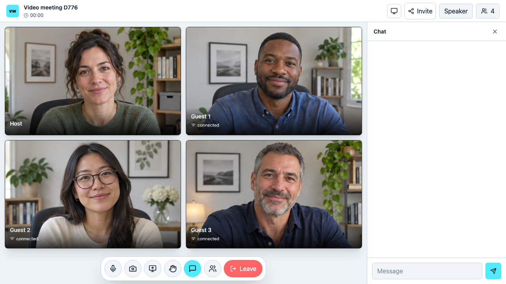

# VideoWhisper WebRTC Video Conference

Free, self-hostable small-group video meetings for PHP and WordPress. Share one invitation, then meet with camera, microphone, screen sharing and text chat. No app download is required for participants.

**[Try the conference demo](https://demo.videowhisper.com/video-conference/)** · **[WordPress plugin](https://wordpress.org/plugins/videowhisper-video-conference/)** · **[Support](https://consult.videowhisper.com/)**



*Captured interface with AI-generated participant images for illustration. The hosted demo may run an earlier build than the latest source release.*

## Meetings that are easy to join

- Create a room once and share its invitation. A private invitation includes the room access key; keep the complete URL confidential.
- Public, signed-in and private rooms, with optional site-wide WordPress role restrictions.
- Gallery/speaker layouts, responsive chat and participant panels, screen sharing, raised hands, host mute requests, removal and room locking.
- Camera/microphone selection, local device checks and connection diagnostics that omit credentials, device IDs, IP addresses and SDP.
- System/light/dark appearance. The participant’s saved browser choice takes priority over a site default.
- **Optional push to talk:** hold the talk button, or focus it and hold Space/Enter, to speak. Release to mute. Focus loss, a hidden tab, host mute requests, device replacement and reconnect close the microphone. Turning the mode off leaves the microphone muted until the participant unmutes it.

The Free edition uses peer-to-peer WebRTC mesh for up to four participants. It does not include recording, SFU, restreaming or scheduling. A compatible signaling server and suitable STUN/TURN service are required. Media quality, network reachability and server-account quotas affect practical capacity. Basic meetings remain available without connecting a CRM account.

## WordPress

Install **VideoWhisper Video Conference** from WordPress.org. Open **Video Conference → Settings**:

1. Configure your own compatible server manually, or use **VideoWhisper connection** for optional turnkey setup. Existing contacts can request an email login code; new contacts load the registration form with consent. A compatible provider can supply a free testing account or import an existing paid account and safely configure an empty dedicated callback. Provider terms and availability apply.
2. Use **Access** to choose who can manage rooms and join meetings. Until Access is explicitly saved, inherited WordPress publishing permissions remain in effect.
3. Use **Pages** to create/select a frontend management page. `[videowhisper_conference_manager]` lets authorized managers create, edit, invite and move their own rooms to Trash. An individual meeting can be embedded with `[videowhisper_conference id="123"]`.
4. Use **App** to choose a participant limit of two to four, initial layout/panel/theme, media and mute defaults, optional push to talk, screen-sharing button visibility and embed height. Participants still consent before joining and choose their own media controls.

Standard requests640×360 at15fps with180kbps video/32kbps audio. Economy requests320×180 at10fps with90/24. Actual quality depends on hardware and the network. Screen-sharing visibility is a presentation preference, not a server authorization rule. After changing capacity, everybody should leave and rejoin so an existing server room can be recreated.

## Build from source

Node.js22+ and Python3 are required. PHP8.2+ is needed for the standalone edition/tests; WordPress6.9+ and PHP8.2+ for the plugin.

```sh
npm ci
npm run lint
npm test
npm run test:php
npm run build
```

`src/` is the readable React client. The build produces self-contained PHP assets in `dist/assets/` and WordPress assets in `dist-wordpress/assets/`, then synchronizes them into the editions. WordPress uses core `wp-element`; it does not bundle another React runtime. Runtime assets are served locally, with no remote executable loader.

`editions/wordpress/` contains readable PHP source. The reusable optional connection template/generator/CSS are under `scripts/streaming-connect/`. Run its generator with `--check` before packaging. Client source and compiled WordPress asset hashes are pinned in `scripts/published-client.json` and the plugin readme. [Build, release and rollback procedure](docs/publishing.md).

For browser tests, install Chromium with `npx playwright install chromium`, then run `npm run test:e2e`, or set `VWC_CHROMIUM_PATH` to an installed Chrome executable. Tests use generated synthetic audio/video, temporary credentials and localhost services. Optional native WordPress cases need an owned disposable fixture as documented in the test sources. `npm run test:server` checks the isolated Free conference protocol fixture; it is not a production server.

## PHP standalone setup

Publish the files in `editions/php/` to an HTTPS PHP host. Configure `VWC_SOCKET_URL`, `VWC_ACCOUNT`, `VWC_ACCOUNT_TOKEN`, `VWC_SIGNING_KEY` and `VWC_STORAGE_DIR` privately outside the public webroot, following [the edition instructions](editions/php/README.md). Do not publish account tokens or signing keys. Use a dedicated compatible conference account/callback; never overwrite another application’s account callback.

The setup has generated editable room/guest names, public-room discovery and public/private invitations. Demo abuse limits and idle-room cleanup are included. Review hosting/account quotas, privacy, retention and TURN configuration before public launch. No media is recorded by this application.

## Server and hosting

The [Free VideoWhisper WebRTC server](https://github.com/videowhisper/videowhisper-webrtc) supports the conference namespace. Use a maintained compatible server with conference support enabled and account authentication configured; see [the protocol](docs/protocol.md). Signaling disconnection alone does not terminate media already exchanged directly between peers.

For managed infrastructure, see **[WebRTC hosting](https://webrtchost.com/)** or **[turnkey live-streaming sites](https://site2stream.com/live/)**. For implementation help, account questions and support, contact **[VideoWhisper](https://consult.videowhisper.com/)**.

License: **GPL-2.0-or-later**. See `LICENSE` and `THIRD-PARTY-NOTICES.txt`. Marketing images are illustrations; user media and private configurations are not part of this repository.
